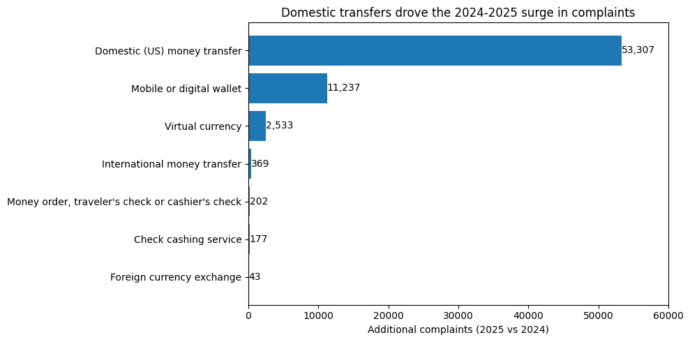
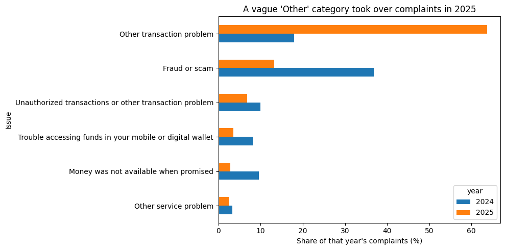
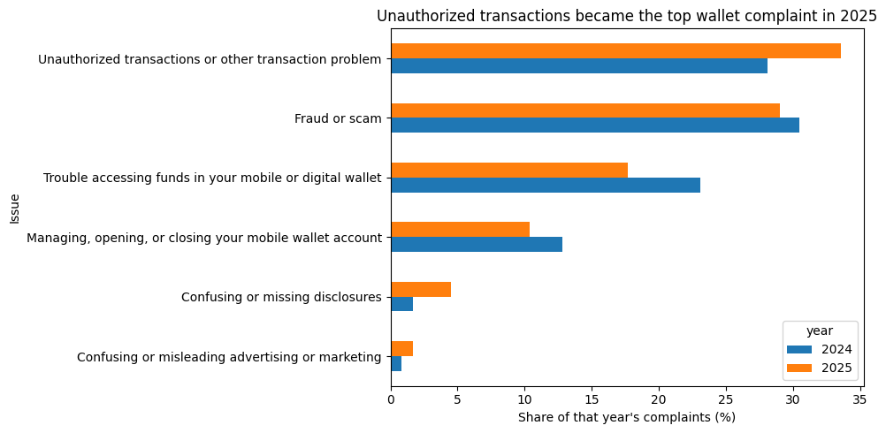
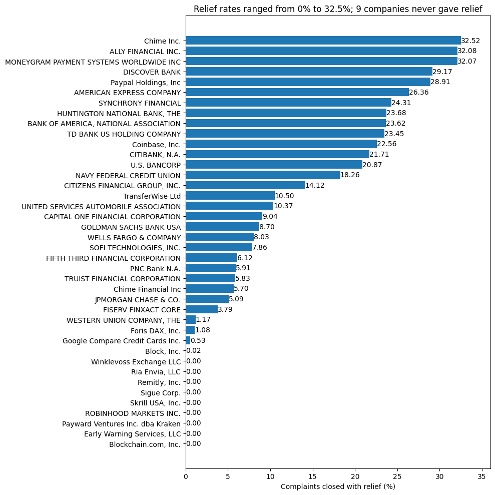

# Money-transfer and payment-app complaints: what drove the 2025 surge?

Complaints to the US Consumer Financial Protection Bureau (CFPB) about money transfers, digital wallets and similar services went from 16,751 in 2024 to 84,619 in 2025. I used Python to find out where that increase came from, what customers were complaining about, and how companies handled the complaints.

The data is real: 101,370 complaints downloaded from the public [CFPB Consumer Complaint Database](https://www.consumerfinance.gov/data-research/consumer-complaints/).

## Main findings

- Domestic money transfers account for 78.5% of the increase in complaints, and digital wallets for 16.6%. All other sub-products barely changed.
- Two companies account for 85.7% of the increase: Block, Inc. (Cash App) and Early Warning Services (Zelle).
- In 2025, 63.7% of complaints were filed as "Other transaction problem", up from 18.0% in 2024. Because 88.3% of 2025 domestic-transfer complaints carry this label, the data can't tell us what went wrong for most of the surge.
- Digital-wallet complaints are more specific. In 2025, unauthorized transactions (33.6%) and fraud or scams (29.0%) made up 62.6% of them.
- 98.6% of complaints got a timely response. Sigue Corp. (57.4%) and Chime Inc. (79.1%) were the clear exceptions.
- Relief rates ranged from 0% to 32.5%. Nine of the 40 companies with at least 100 complaints never closed a complaint with relief, and Block and Early Warning gave relief on only 7 of about 64,700 complaints.

## Business questions

1. Which sub-products and companies account for the increase in complaints from 2024 to 2025?
2. What are the most common issues, and did they change between the two years?
3. Among companies with at least 100 complaints, which respond on time, and which give customers relief?

## Data

I filtered the CFPB database to the product "Money transfer, virtual currency, or money service" and to complaints received from January 2024 to December 2025. That gave 101,370 complaints with 15 columns, including the sub-product, issue, company, state, response type and whether the response was on time.

The website only allows filtered downloads of up to 100,000 complaints, so I exported each year as a separate file (16,751 and 84,619 rows) and combined them in pandas. The CSV files are not included in this repository; the steps to download them are under [How to run it](#how-to-run-it).

## How I cleaned the data

Before any analysis, I checked that the row counts matched the CFPB website, that each file covered exactly one calendar year, and that every complaint ID was unique after combining the two files.

Blanks meant different things in different columns, so I handled each column on its own:

| Column | Missing | What a blank means | What I did |
|---|---|---|---|
| Sub-issue | 100% | the column is empty | dropped it |
| ZIP code | 0%, but often masked (e.g. XXXXX) | hidden for privacy | dropped it and used State for location |
| Company public response | 91.0% | the company chose not to respond publicly | filled with "No public response" |
| Tags | 90.6% | no Older American or Servicemember tag was reported | filled with "No tag" |
| State | 2.2% | the consumer gave no mailing state | filled with "Unknown", so these complaints stay in every other analysis |

I also converted both date columns from text to dates.

## Findings

### 1. Where the surge came from

Domestic money transfers grew from 4,548 to 57,855 complaints, which is 78.5% of the total increase of 67,868. Digital-wallet complaints nearly tripled, from 5,913 to 17,150, and account for another 16.6%.

Within domestic transfers, Block, Inc. accounts for 62.7% of the increase and Early Warning Services for 32.9%. Across both sub-products, Block alone accounts for 57.9% of the whole surge.

These are complaint counts. Apps with more users get more complaints, so on their own these numbers show where complaints grew and say nothing about service quality.

### 2. What customers complained about

2025 had about five times as many complaints as 2024, so I compared each issue's share of its own year instead of raw counts.

"Other transaction problem" went from 18.0% of complaints in 2024 to 63.7% in 2025. Fraud or scam complaints still grew in number (6,173 to 11,179), but their share fell from 36.9% to 13.2%.

The growth of this vague category and the domestic-transfer surge are largely the same complaints: 94.8% of the 2025 "Other" complaints were domestic transfers, and 88.3% of 2025 domestic-transfer complaints were filed as "Other". For most of the increase, the issue categories don't say what actually went wrong. Finding out would take the consumers' written descriptions, which aren't in the files I downloaded.

Wallet complaints never use the "Other transaction problem" label. In 2025, unauthorized transactions (33.6%, up from 28.1%) and fraud or scams (29.0%) made up 62.6% of them, so most wallet complaints are about customers losing money, either without their permission or through a scam.

### 3. How companies handled complaints

Timeliness and outcome are separate fields in the data. 98.6% of complaints got a timely response. Of the 1,414 late ones, 1,209 were still closed with an explanation, and 161 are recorded as "Untimely response".

To keep the rates reliable, I only compared the 40 companies with at least 100 complaints. Together they cover 96,998 complaints, or 95.7% of the total.

Sigue Corp. responded on time to 57.4% of its complaints and Chime Inc. to 79.1%, against 98.6% overall.

I defined the relief rate as the complaints closed with monetary or non-monetary relief, divided by all complaints except the ones still "In progress". Untimely responses count as no relief, because from the customer's side nothing was resolved.

Relief rates ranged from 0% to 32.5%. Nine companies never closed a complaint with relief, including Early Warning Services across 20,186 complaints. Block gave relief on 7 of its 44,495 complaints. Chime Inc. was slow to respond but had the highest relief rate, at 32.5%.

Chime appears in the CFPB data under two company names, Chime Inc. and Chime Financial Inc. Both have complaints in both years, so I kept them separate, as the CFPB lists them.

## Limitations

- The data shows where complaints grew, but not why. It has no information on user numbers, marketing, or changes in how the CFPB handles complaints.
- Complaint counts are not rates. Bigger companies have more customers and so more complaints.
- Companies choose their own response type, for example "Closed with monetary relief". A 2015 federal audit found that the CFPB did not review all of these choices against its definitions.
- "No tag" means the consumer did not report being an older American or a servicemember. It doesn't mean they aren't one.
- Percentages may not add up to exactly 100% because of rounding.

## Tools

Python (pandas and matplotlib) in Google Colab, with the data stored in Google Drive.

## Repository contents

| File | Contents |
|---|---|
| `CFPB_Complaints_Analysis.ipynb` | the notebook, with all code, checks and charts |
| `images/` | the charts used in this README |
| `README.md` | this file |

## How to run it

1. On the [CFPB Consumer Complaint Database](https://www.consumerfinance.gov/data-research/consumer-complaints/), filter to the product "Money transfer, virtual currency, or money service" and export one file for 2024 (January 1 to December 31) and one for 2025.
2. Save them as `complaints-2024.csv` and `complaints-2025.csv` in a Google Drive folder called `CFPB Project`.
3. Open the notebook in Google Colab, choose Runtime > Run all, and allow access to Google Drive when asked.

The database is updated over time, so a new download may give slightly different counts.

## Related projects

- [Digital wallet SQL analysis](https://github.com/sheha61-boop/digital-wallet-sql-analytics)
- [Subscription app SQL analysis](https://github.com/sheha61-boop/subscription-app-sql-analytics)
- [Subscription app Power BI dashboard](https://github.com/sheha61-boop/subscription-app-powerbi-dashboard)

## Author

Menna Sheha. [LinkedIn](https://www.linkedin.com/in/menna-sheha) | [GitHub](https://github.com/sheha61-boop)
